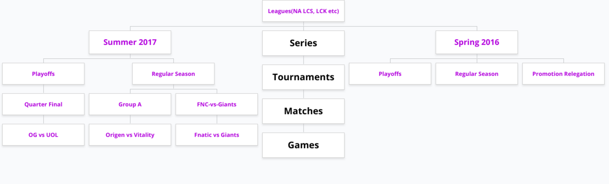

# Documentation de la Branche `dev`

Cette branche est exclusivement dédiée à la gestion, à la collecte automatisée et à la mise à disposition des données liées au secteur de l'e-sport.

---

## Architecture et Flux de Données

  <!-- Insérer le chemin vers l'image du schéma ci-dessous -->
  

Ce diagramme présente l'organisation hiérarchique des données e-sport issues de l'API, structurée en cinq niveaux d'imbrication : des ligues (Leagues) jusqu'aux parties individuelles (Games), en passant par les saisons (Series), les phases de compétition (Tournaments) et les rencontres (Matches).   
---

## Structure du Projet

L'arborescence de cette branche est organisée en trois composants principaux :

### 1. Récolte de Données
* **`data_recolt/`** :
  * `main.py` et `league.py` : Scripts responsables de l'extraction des informations et de l'interrogation de l'API externe.
* **`data/`** : Répertoire de stockage centralisant les fichiers JSON de données brutes, actualisés automatiquement lors de chaque détection de nouvelles informations par le bot GitHub Actions.
* **`.github/workflows/`** : Contient le fichier de configuration CI/CD (`scrape.yml`) responsable du déclenchement automatisé de la collecte.

### 2. API (Back-End)
* **`api/`** : Contient le service dorsal développé sous FastAPI, structuré pour exposer les données :
  * `routers/` : Endpoints modulaires classés par thématiques (`leagues`, `matches`, `series`, `tournaments`) permettant des requêtes par date, période ou en temps réel.
  * `services/` : Logique métier pour la manipulation et la récupération des données.
  * `main.py` : Point d'entrée de l'application API.
  * `requirements.txt` : Dépendances techniques du back-end.

### 3. Interface (Front-End)
* **`app/`** : Contient l'application utilisateur (Streamlit) :
  * `main.py` : Point d'entrée de l'interface graphique.
  * `Dockerfile` : Fichier de configuration pour la conteneurisation.
  * `requirements.txt` et `style.css` : Dépendances et feuilles de style graphiques de l'interface.

---

## Accès à l'Application

L'interface de visualisation et les tableaux de bord interactifs sont accessibles en ligne à l'adresse suivante :

**[Accéder à l'application Streamlit E-Sport](https://sportsphere--e-sport--su5tg7bewzslvsuaku85vv.streamlit.app/)**